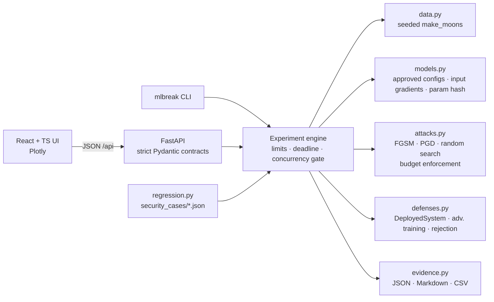

# MLBreak

**An adversarial machine learning security lab for breaking, measuring, hardening, replaying and
regression-testing traditional ML models — organised around the
[OWASP Machine Learning Security Top 10 (2023)](https://owasp.org/www-project-machine-learning-security-top-10/).**

> ⚠ **Intentionally vulnerable.** MLBreak deliberately ships an undefended model so that real
> attacks succeed against it. It is for education and defensive research. Run it locally; do not
> expose it to a network. See [docs/responsible-use.md](docs/responsible-use.md).

## Status

| OWASP category | Lab |
|---|---|
| **ML01:2023 Input Manipulation Attack** | ✅ implemented, **two scenarios**: 2-D classifier evasion, and spam-filter evasion with character-level adversarial text |
| **ML02:2023 Data Poisoning Attack** | ✅ implemented: label flipping with retraining, kNN label sanitisation |
| **ML03:2023 Model Inversion Attack** | ✅ implemented: private-attribute inversion of a risk-scoring service, compared with an auxiliary-only attacker; quantised and label-only output policies |
| **ML04:2023 Membership Inference Attack** | ✅ implemented: training-set membership inference with a calibrated threshold attack and a shadow-model attack; regularisation, complexity reduction and output restriction evaluated by recalibrated attacks |
| ML05–ML10:2023 | registry metadata only. **No lab, no placeholder attacks.** |

The first release is a working vertical slice, not a scaffold. Every metric in the UI, CLI and
reports comes from an experiment that actually ran.

## Quickstart

```bash
make install && make ui     # Python venv + dependencies, then build the web UI (needs Node 18+)
make run                    # http://127.0.0.1:8000 — UI and API (API docs at /docs)
make test && make verify    # test suite, then the security regression gate
make demo                   # all four labs end to end from the CLI
docker compose up --build   # alternative: everything in a hardened container on 127.0.0.1:8000
```

The web UI lives in `frontend/`: run npm there (`cd frontend && npm install && npm run dev`) or use `make dev`, which
serves the UI with hot reload on http://127.0.0.1:5173 and needs the API (`make run`) in another terminal.
Running `npm` in the repository root fails with `ENOENT … package.json`.

## Laboratories

| Scenario | OWASP | Attack | Defenses (evaluated by replay **and** adaptive attack unless noted) | Regression cases | Guide |
|---|---|---|---|---|---|
| **2D Classifier Evasion** | ML01:2023 | FGSM, PGD (white-box), random search (black-box) | adversarial training, confidence rejection | MLB-REG-001…004 | [methodology](docs/methodology.md) |
| **Spam Filter Evasion** | ML01:2023 | DeepWordBug-style character edits (black-box), under text-preservation constraints | text normalisation, adversarial data augmentation | MLB-REG-009…013 | [ml01-spam-filter-evasion](docs/ml01-spam-filter-evasion.md) |
| **Label-Flipping Poisoning** | ML02:2023 | random / targeted label flipping + retraining | kNN label sanitisation (replay only — no adaptive poisoner) | MLB-REG-005…008 | [ml02-data-poisoning](docs/ml02-data-poisoning.md) |
| **Training Set Membership Inference** | ML04:2023 | calibrated threshold attack (confidence / loss / max-confidence) and shadow models + meta-classifier, calibrated on the attacker's own reference models | leaf-size regularisation, complexity reduction, quantised / label-only output (recalibrated attacks) | MLB-REG-019…025 | [ml04-membership-inference](docs/ml04-membership-inference.md) |
| **Private Attribute Inversion** | ML03:2023 | black-box candidate matching (bounded queries), vs an auxiliary-only attacker | quantised probability, label-only output (adaptive only — replay does not apply) | MLB-REG-014…018 | [ml03-model-inversion](docs/ml03-model-inversion.md) |

Every lab follows the same four steps in the UI — **Baseline → Attack → Defend → Evidence & replay** — with the
same actions (*Run baseline*, *Replay against defense*, *Run adaptive attack*, *Verify*, *Replay*) and the same
seven-section evidence report ([docs/evidence.md](docs/evidence.md)). Open them from **Attack Lab** (ML01 has a
scenario selector) or from the **OWASP ML Top 10** page.

### ML01 · 2D Classifier Evasion

A classifier (`MLPClassifier`, tanh 16×16, or logistic regression for contrast) is trained on a
seeded `make_moons` dataset. In the lab you can:

1. **Baseline.** Evaluate the unmodified model on clean test data and inspect its decision boundary.
2. **Attack.** Pick a sample (or the whole test split) and craft an adversarial perturbation within an
   L∞/L2 budget ε:
   * **FGSM** (white-box, one step) and **PGD** (white-box, iterative). Both use exact input
     gradients, computed analytically and checked against finite differences.
   * **Random search** (black-box, decision-based). It sees only the returned label and has a
     counted query budget.
3. **Defend.** Apply a real control and evaluate it two separate ways:
   * **Replay**: the *exact* perturbations from the attack experiment are re-submitted to the
     defended system (non-adaptive attacker).
   * **Adaptive attack**: a *new* attack experiment is generated against the defended system by an
     attacker who knows the defense.
   * Controls: **adversarial training** (model-level) and **confidence rejection** (system-level
     abstention).
4. **Replay** any experiment from its recorded request and verify bit-identical results.
5. **Export evidence**: JSON (`mlbreak.experiment/v2`; v1 records still load), a Markdown report and a per-sample CSV.
   Every record carries SHA-256 fingerprints and can be verified without re-running it (`mlbreak check`); replays refuse records that fail verification. This is an integrity check, **not authenticity**: anyone who can rewrite an evidence file can recompute its hashes (see [reproducibility.md](docs/reproducibility.md#integrity-is-not-authenticity)).
6. **Security regression**: declared invariants in `security_cases/` are re-checked by
   `mlbreak verify` and by pytest.

Reference results (seed 7, MLP, PGD L∞ ε=0.3, 150 test samples), produced by `mlbreak demo` on macOS arm64 (Apple Accelerate):

| Evaluation | Clean accuracy | Adversarial accuracy | Robust accuracy | Attack success | Adversarial abstention |
|---|---|---|---|---|---|
| Undefended | 96.7% | 58.7% (88/150) | 58.7% (88/150) | 39.3% (57/145) | 0.0% (0/145) |
| Adversarial training, replay | 96.7% | 84.0% (126/150) | 83.3% (125/150) | 13.2% (19/144) | 0.0% (0/144) |
| Adversarial training, **adaptive** | 96.7% | 72.0% (108/150) | 72.0% (108/150) | 25.5% (37/145) | 0.0% (0/145) |
| Confidence rejection τ=0.8, replay | 86.7% (coverage 88.7%) | 35.3% (53/150) | 35.3% (53/150) | 0.0% (0/130) | **59.2% (77/130)** |
| Confidence rejection τ=0.8, **adaptive** | 86.7% (coverage 88.7%) | 35.3% (53/150) | 35.3% (53/150) | 15.4% (20/130) | 43.8% (57/130) |
| Black-box random search, 500 queries/sample | 96.7% | 59.3% (89/150) | 59.3% (89/150) | 38.6% (56/145) | 0.0% (0/145) |

The rejection rows are the point of the lab. Replay makes that defense look perfect (0% success);
an adaptive attacker shows it is not. Note what the replay row really says: most replayed inputs are
*abstained on*, not classified correctly, so adversarial accuracy is 35.3%, not the 86.7% an
earlier formula reported by counting abstentions as correct. Metric definitions are in
[docs/methodology.md](docs/methodology.md#metrics). Adversarial and robust accuracy differ only when a
correctly classified sample was not perturbed by the replayed parent (one sample in the AT replay row).

**Numbers depend on the numerical environment, not only on the code.** With identical package versions, the
BLAS library and CPU kernel change the trained model. Most rows move by a sample or two, but the adaptive
attack against adversarial training ranges from **25.0% to 31.7%** across the 7 environments tested (31.7% on
the CI reference, Linux x86_64 / OpenBLAS Haswell). In every one of them, adversarial training still reduces
adaptive success significantly on the same samples (McNemar p ≤ 0.004, −8.3 to −14.6 pp). See
[docs/regression-analysis-mlb-reg-002.md](docs/regression-analysis-mlb-reg-002.md) and
[docs/reproducibility.md](docs/reproducibility.md#numerical-environment-and-dependency-strategy).

### ML01 · Spam Filter Evasion

A second ML01 scenario ([docs/ml01-spam-filter-evasion.md](docs/ml01-spam-filter-evasion.md)), selected in the
Attack Lab with **ML01 scenario → Spam Filter Evasion**. A TF-IDF + logistic-regression (or naive-Bayes) spam
filter is trained in-process on the bundled **SMS Spam Collection** (CC BY 4.0, de-duplicated before a seeded
stratified split). It is attacked with a **DeepWordBug-style** black-box search (swap, substitute, delete or
insert characters) under explicit constraints: edit distance, altered-character ratio, modified-word ratio,
protected numbers/URLs and function words, and a per-message query budget enforced by a counting oracle. A label
change only counts as an evasion if every constraint holds. Defenses are text normalisation (Unicode, leetspeak,
spell-snap to the training vocabulary) and adversarial data augmentation from training spam, each evaluated by
replay and by a fresh adaptive attack.

| Seed 7, 93 attackable held-out spam (logistic regression) | Attack success |
|---|---|
| Undefended, default constraints | 25/93 = 26.9% |
| … if phone numbers may be corrupted | 53/93 = 57.0% |
| Normalisation: replay → adaptive (2 edits/word, 400 queries) | 4/93 → 16/93 |
| Augmentation: replay → adaptive | 5/91 → 14/91 |
| Invisible zero-width insertion → Unicode normalisation | 41/93 → 0/93 |

The design follows the SpamShieldAI red-team notebook (BERT + TextAttack `DeepWordBugGao2018` on 10 messages),
re-implemented for traditional ML with tighter constraints. Its historical results are illustrative and are
not used as thresholds.

### ML02 · Label-Flipping Poisoning

The same bundled dataset and model configurations, attacked through **training labels** instead of test
inputs ([docs/ml02-data-poisoning.md](docs/ml02-data-poisoning.md)):

1. **Baseline**: the reference model, trained on the true (clean) labels.
2. **Poison and retrain**: flip the labels of a bounded fraction of the training set, chosen at random,
   from one target class, or from the target-class rows nearest the clean boundary (seeded and
   budget-verified). The model is then actually retrained. The UI shows the clean and poisoned decision
   boundaries, the flipped rows, and the test samples the poisoning broke.
3. **Defensive replay**: replay the *exact* poisoned training set through kNN label sanitisation (relabel or
   remove), retrain, and report detection precision/recall, false positives, recovery, and the defense's
   cost on clean data.

| Poisoning (MLP, seed 7) | Undefended ASR | kNN detects | Defended ASR |
|---|---|---|---|
| random 20% | 3.4% (5/145) | 61/70 | 1.4% |
| targeted class 1, 10%, random rows | 5.6% (4/71) | 31/35 | 2.8% |
| targeted class 1, 10%, **boundary rows** | **23.9%** (17/71) | **0/35** | 22.5% |
| targeted class 1, 20%, random rows | **47.9%** (34/71) | 28/70 | **52.1%** (worse) |

### ML03 · Private Attribute Inversion

A fictional account-risk service (logistic regression on **synthetic** records) takes four public features and a
confidential binary attribute as inputs ([docs/ml03-model-inversion.md](docs/ml03-model-inversion.md)):

1. **Baseline**: victim utility, how much the attribute matters to the prediction, and an **auxiliary-only
   attacker** that guesses the attribute from public data alone (no queries).
2. **Attack**: knowing a held-out target's public features and the service's output for that record, the attacker
   queries the black-box service with s = 0 and s = 1 and keeps the candidate that reproduces the observed output.
   The attack code only ever sees an attacker view and a counting oracle; ground truth stays with the evaluator.
   The UI shows each step of the trace and which information the adversary had.
3. **Defend**: a NEW adaptive inversion against a quantised or label-only output policy, on the same targets,
   with a privacy–utility comparison.

| Seed 7, 200 targets | Correct reconstructions | Advantage over auxiliary-only (138/200) | Ranking AUC of released output |
|---|---|---|---|
| full probability | 200/200 | +31.0 pts, leakage claimed (p = 2e-19) | 0.839 |
| 4-bucket quantisation | 193/200 | +27.5 pts, claimed | 0.820 |
| label only | 168/200 | +15.0 pts, claimed (p = 9e-10) | 0.753 |
| negative control (model ignores the attribute) | 138/200 | 0, **not** claimed | 0.798 |

High accuracy alone is never reported as leakage; output restriction is not a formal privacy guarantee. Attackers query over HTTP only through evaluator-issued, budgeted
**attack sessions** (`ml03-attacker` endpoints, which return no ground truth). Setting `MLBREAK_EVALUATOR_TOKEN` puts
every other endpoint behind a bearer token. A sensitivity study (`mlbreak invert sensitivity`) tests each attacker
assumption against the auxiliary-only baseline on identical targets.

### ML04 · Training Set Membership Inference

A fictional transaction-risk classifier is trained on 600 **synthetic** records with noisy labels
([docs/ml04-membership-inference.md](docs/ml04-membership-inference.md)). Six disjoint populations (checked row by
row) separate the victim's training and held-out data, the attacker's shadow and calibration data, the evaluation
non-members and a decoy set:

1. **Baseline**: training vs held-out accuracy (the generalisation gap) and the no-signal baseline.
2. **Attack**: one query per candidate (250 members + 250 non-members). A threshold attack and a shadow-model attack
   (8 shadow models + gradient-boosting meta-classifier) are calibrated **only** on reference models the attacker
   trains on its own data; the evaluation candidates' membership stays with the evaluator. ROC curve, confusion
   matrices, TPR at a calibrated 1% FPR and projected precision at low prevalence are reported.
3. **Defend**: each defense is attacked by a **recalibrated** attack on the same candidates, with utility reported.

| Seed 7, 500 candidates | Held-out acc. | Threshold AUC | Shadow AUC | Advantage (TPR − FPR) | Leakage |
|---|---|---|---|---|---|
| overfit random forest | 0.725 | 0.896 | 0.895 | +0.616 | claimed (p ≈ 2e-53) |
| + leaf-size regularisation | 0.703 | 0.568 | 0.539 | +0.048 | residual (threshold p = 0.0045) |
| + complexity reduction | 0.678 | 0.597 | 0.606 | +0.128 | claimed |
| + 4-bucket quantisation | 0.725 | 0.817 | 0.826 | +0.608 | claimed — no significant reduction on any of 20 seeds |
| + label-only output | 0.725 | 0.640 | 0.661 | +0.280 | claimed — correctness still leaks to a label-aware attacker |
| negative control (decoy: no candidate is a member) | 0.702 | 0.498 | 0.505 | +0.000 | **not** claimed |

A 20-seed study (`mlbreak member study --seeds 0-19`) backs the regression thresholds and documents where defenses
fail. None of these defenses is differential privacy.

## Architecture



| Path | Responsibility |
|---|---|
| `src/mlbreak/owasp.py` | Registry and metadata contract for ML01–ML10:2023 |
| `src/mlbreak/data.py` | Bundled, approved, generated datasets (read-only arrays, hashed) |
| `src/mlbreak/models.py` | Approved model configs, differentiable forward pass, artifact hash |
| `src/mlbreak/attacks.py` | Attacks, ε/domain projection, `enforce_constraints` |
| `src/mlbreak/defenses.py` | Deployed system (model + decision policy) and defenses |
| `src/mlbreak/experiments.py` | Baseline / attack / defend / adaptive / replay, metrics |
| `src/mlbreak/evidence.py` | Evidence store and Markdown report |
| `src/mlbreak/regression.py` | Security regression runner |
| `src/mlbreak/api.py`, `cli.py` | Web API and command line |
| `src/mlbreak/text/` | ML01 spam-filter evasion: bundled corpus, TF-IDF models, DeepWordBug-style attack, normalisation, augmentation, metrics, integrity |
| `src/mlbreak/poisoning/` | ML02 data poisoning: label flipping, kNN sanitisation, metrics, integrity |
| `src/mlbreak/inversion/` | ML03 model inversion: synthetic data, victim/auxiliary models, prediction service and output policies, attacker-side candidate matching, metrics, integrity |
| `src/mlbreak/membership/` | ML04 membership inference: disjoint populations, victims, prediction service, threshold and shadow-model attacks, calibration, metrics, integrity, multi-seed study |
| `frontend/` | React + TypeScript UI |
| `security_cases/` | Declared defensive invariants |

**Vulnerable behaviour and security controls are separate.** The undefended model is the default
`DeployedSystem`. Controls are opt-in wrappers or retrained models, configured only through typed
`DefenseConfig` objects.

*Design reference:* the Normal/Attack/Secure workflow, evidence and regression-case ideas follow the
methodology of [AgentBreak](https://github.com/urcuqui/AgentBreak). That repository has no license
file, so **no code was copied**; MLBreak is an independent implementation.

## Install & run

Requirements: Python 3.11+, Node 18+ (to build the UI). Docker is optional.

```bash
make install        # .venv + pip install -e ".[dev]"
make ui             # build the React UI into frontend/dist
make run            # http://127.0.0.1:8000  (API docs at /docs)
```

Without `make`:

```bash
python3.12 -m venv .venv && .venv/bin/pip install -e ".[dev]"
(cd frontend && npm ci && npm run build)
PYTHONPATH=src .venv/bin/python -m mlbreak serve
```

Reproducible install (what CI does: hash-pinned numerical stack, then the project without re-resolving):

```bash
pip install --require-hashes -r requirements/ci-py3.12.txt   # or ci-py3.11.txt
pip install --no-deps -e .
OPENBLAS_CORETYPE=Haswell python -m mlbreak verify           # Linux x86_64: same BLAS kernel as CI
python -m mlbreak env                                         # print your numerical environment
```

Docker (UI built in the image, hash-pinned runtime dependencies, published on 127.0.0.1 only, read-only filesystem, all capabilities dropped):

```bash
docker compose up --build    # http://127.0.0.1:8000
```

UI development with hot reload: `make run` in one shell, `make dev` in another (http://127.0.0.1:5173).

## Test, verify, demo

```bash
make test           # pytest: unit + integration + API + regression + static security checks
make verify         # security regression gate, non-zero exit on failure
make demo           # all labs: ML01 2-D (baseline → attack → replay/adaptive → black-box → exact replay), ML01 spam, ML02, ML03, ML04
PYTHONPATH=src .venv/bin/python -m mlbreak demo --lab ml01-spam   # ML01 spam filter: attack → replay/adaptive per defense
PYTHONPATH=src .venv/bin/python -m mlbreak demo --lab ml02   # ML02: clean → poison → defensive replay → replay
PYTHONPATH=src .venv/bin/python -m mlbreak demo --lab ml03   # ML03: baseline → inversion → output policies → negative control → replay
PYTHONPATH=src .venv/bin/python -m mlbreak demo --lab ml04   # ML04: baseline → membership inference → 4 defenses → controls → replay
PYTHONPATH=src .venv/bin/python -m mlbreak demo --lab all
```

CLI reference (`PYTHONPATH=src .venv/bin/python -m mlbreak …`, or `mlbreak …` if the entry point is on PATH):

```bash
mlbreak baseline [--model logreg] [--seed 7] [--defense confidence_rejection --threshold 0.9]
mlbreak attack --attack pgd --norm linf --epsilon 0.3 --steps 40
mlbreak attack --attack random_search --queries 500
mlbreak defend <ATTACK_ID> --defense adversarial_training          # replay
mlbreak attack --defense adversarial_training --parent <ATTACK_ID>  # adaptive (same ε, norm and samples as the parent)
mlbreak text classify "WINNER! Claim your prize, call 09061701461"
mlbreak text attack --samples 100 [--max-edits 10] [--operations insert --charsets invisible]
mlbreak text defend <ATTACK_ID> --defense text_normalization|text_adversarial_training
mlbreak text attack --defense text_normalization --parent <ATTACK_ID> --edits-per-word 2 --queries 400   # adaptive
mlbreak poison baseline [--model logreg] [--seed 7]
mlbreak poison attack --strategy random --fraction 0.2
mlbreak poison attack --strategy targeted --target-class 1 --fraction 0.1 --selection boundary
mlbreak poison defend <POISON_ID> [--k 10] [--threshold 0.5] [--action relabel|remove]
mlbreak replay <ID>         # verifies integrity first (exit 3 if tampered); exit 0 only if bit-identical
mlbreak check <ID> [--json] # evidence integrity: hashes + metrics re-derived from per-sample results
mlbreak export <ID> --format md|json
mlbreak list
```

Evidence is written to `var/experiments/` (override with `MLBREAK_DATA_DIR`).

## Security properties of the platform

* Local-first: binds `127.0.0.1` by default and warns otherwise. No external credentials, no telemetry.
* Experiments never use the network. Datasets are generated, not downloaded. A static test fails if
  experiment modules import networking or deserialisation libraries.
* No arbitrary code execution. No `eval`/`exec`. Requests are strict Pydantic models with
  `extra="forbid"`, enumerated scenarios, models and attacks, and bounded numeric fields.
* No uploads and no pickle or joblib. Models are retrained from approved configurations, and
  artifacts are identified by a SHA-256 over their parameter arrays.
* Resource limits ([config.py](src/mlbreak/config.py)): ε ≤ 1, steps ≤ 200, ≤ 300 samples,
  ≤ 2000 queries/sample, 60 s wall-clock per experiment, 2 concurrent experiments (HTTP 429 beyond that).
* Experiment IDs are validated against a strict pattern before any filesystem access, which prevents
  path traversal.
* A CSP (`default-src 'self'`) and anti-framing headers are set on the UI.

## Data and licensing

* **Datasets:** `moons-v1` and `synthetic-account-risk-v1` (ML03, fictional records) are generated at runtime; the **SMS Spam Collection v.1** (Almeida & Gómez Hidalgo,
  UCI, DOI 10.24432/C5CC84) is bundled under **CC BY 4.0** with its attribution
  ([docs/datasets.md](docs/datasets.md)). Nothing is downloaded at runtime.
* **Software license: not yet chosen.** There is no `LICENSE` file, so the code is under default copyright and
  others have no right to reuse it. The options and their consequences are laid out in
  [docs/licensing.md](docs/licensing.md); **a maintainer decision is required** before the project is presented
  as open source. All dependencies are permissive (BSD/MIT/Apache-2.0) and compatible with every option listed.

## Documentation

* [ML01 spam-filter evasion: reference analysis, threat model, constraints, defenses, limitations](docs/ml01-spam-filter-evasion.md)
* [ML02 data poisoning: threat model, metrics, assumptions, limitations](docs/ml02-data-poisoning.md)
* [ML03 model inversion: threat model, attack, baseline comparison, output policies, privacy–utility, limitations](docs/ml03-model-inversion.md)
* [ML04 membership inference: threat model, populations, calibration vs evaluation, threshold and shadow attacks, defenses, negative controls, limitations](docs/ml04-membership-inference.md)
* [Threat model](docs/threat-model.md)
* [Experimental methodology](docs/methodology.md)
* [OWASP mapping](docs/owasp-mapping.md)
* [Limitations](docs/limitations.md)
* [Reproducibility](docs/reproducibility.md): integrity vs authenticity, dependency locks, numerical environments
* [MLB-REG-002 root-cause analysis](docs/regression-analysis-mlb-reg-002.md)
* [Responsible use](docs/responsible-use.md)
* [Evidence across laboratories: report structure, verify, replay](docs/evidence.md)
* [HTTP API: error contract, endpoints, examples](docs/api.md)
* [Datasets and attribution](docs/datasets.md)
* [Licensing — maintainer decision required](docs/licensing.md)

## Troubleshooting

**`ModuleNotFoundError: No module named 'mlbreak'` on macOS.** Folders synced by iCloud/Desktop &
Documents can mark files inside `.venv` as hidden, and Python ≥ 3.12 skips hidden `.pth` files, so
the editable install disappears. The Makefile sets `PYTHONPATH=src` to avoid this. Alternatively,
keep the repository outside a synced folder, or run `chflags nohidden .venv/lib/python3.*/site-packages/*.pth`.

**`npm error enoent Could not read package.json`.** npm was run in the repository root. The UI is in `frontend/`:
`cd frontend && npm install && npm run dev`, or `make dev` from the root.

**HTTP 429 in the browser console.** The server runs at most two experiments (or boundary grids) at a time and
refuses extra requests *before* doing any work; the UI queues gated requests and retries, so this is harmless.

## License

**No license has been chosen yet — maintainer decision required.** See [docs/licensing.md](docs/licensing.md)
for the options (MIT, Apache-2.0, BSD-3-Clause, MPL-2.0, GPL-3.0, AGPL-3.0) and the follow-up checklist. The bundled
SMS Spam Collection remains under CC BY 4.0 regardless of the code license.
