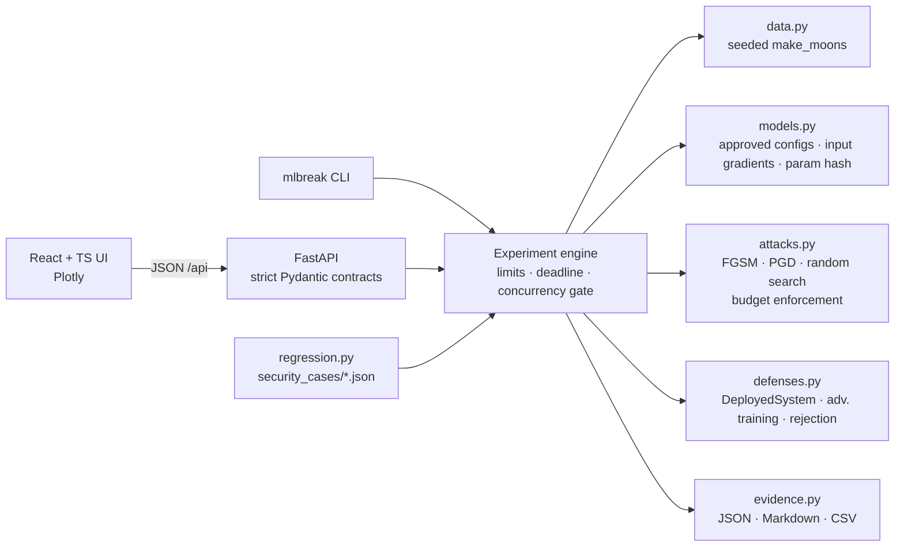

# MLBreak

**An adversarial machine learning security lab for breaking, measuring, hardening, replaying and
regression-testing traditional ML models — organised around the
[OWASP Machine Learning Security Top 10 (2023)](https://owasp.org/www-project-machine-learning-security-top-10/).**

> ⚠ **Intentionally vulnerable.** MLBreak deliberately ships an undefended model so that real
> attacks succeed against it. It is for education and defensive research. Run it locally; do not
> expose it to a network. See [docs/responsible-use.md](docs/responsible-use.md).

## Status

| OWASP category | Lab |
|---|---|
| **ML01:2023 Input Manipulation Attack** | ✅ implemented, **two scenarios**: 2-D classifier evasion, and spam-filter evasion with character-level adversarial text |
| **ML02:2023 Data Poisoning Attack** | ✅ implemented: label flipping with retraining, kNN label sanitisation |
| ML03–ML10:2023 | registry metadata only. **No lab, no placeholder attacks.** |

The first release is a working vertical slice, not a scaffold. Every metric in the UI, CLI and
reports comes from an experiment that actually ran.

## What the ML01 spam-filter scenario does

A second ML01 scenario ([docs/ml01-spam-filter-evasion.md](docs/ml01-spam-filter-evasion.md)), selected in the
Attack Lab with **ML01 scenario → Spam Filter Evasion**. A TF-IDF + logistic-regression (or naive-Bayes) spam
filter is trained in-process on the bundled **SMS Spam Collection** (CC BY 4.0, de-duplicated before a seeded
stratified split). It is attacked with a **DeepWordBug-style** black-box search (swap, substitute, delete or
insert characters) under explicit constraints: edit distance, altered-character ratio, modified-word ratio,
protected numbers/URLs and function words, and a per-message query budget enforced by a counting oracle. A label
change only counts as an evasion if every constraint holds. Defenses are text normalisation (Unicode, leetspeak,
spell-snap to the training vocabulary) and adversarial data augmentation from training spam, each evaluated by
replay and by a fresh adaptive attack.

| Seed 7, 93 attackable held-out spam (logistic regression) | Attack success |
|---|---|
| Undefended, default constraints | 25/93 = 26.9% |
| … if phone numbers may be corrupted | 53/93 = 57.0% |
| Normalisation: replay → adaptive (2 edits/word, 400 queries) | 4/93 → 16/93 |
| Augmentation: replay → adaptive | 5/91 → 14/91 |
| Invisible zero-width insertion → Unicode normalisation | 41/93 → 0/93 |

The design follows the SpamShieldAI red-team notebook (BERT + TextAttack `DeepWordBugGao2018` on 10 messages),
re-implemented for traditional ML with tighter constraints. Its historical results are illustrative and are
not used as thresholds.

## What the ML02 lab does

The same bundled dataset and model configurations, attacked through **training labels** instead of test
inputs ([docs/ml02-data-poisoning.md](docs/ml02-data-poisoning.md)):

1. **Clean training**: the reference model, trained on true labels.
2. **Poison and retrain**: flip the labels of a bounded fraction of the training set, chosen at random,
   from one target class, or from the target-class rows nearest the clean boundary (seeded and
   budget-verified). The model is then actually retrained. The UI shows the clean and poisoned decision
   boundaries, the flipped rows, and the test samples the poisoning broke.
3. **Defensive replay**: replay the *exact* poisoned training set through kNN label sanitisation (relabel or
   remove), retrain, and report detection precision/recall, false positives, recovery, and the defense's
   cost on clean data.

| Poisoning (MLP, seed 7) | Undefended ASR | kNN detects | Defended ASR |
|---|---|---|---|
| random 20% | 3.4% (5/145) | 61/70 | 1.4% |
| targeted class 1, 10%, random rows | 5.6% (4/71) | 31/35 | 2.8% |
| targeted class 1, 10%, **boundary rows** | **23.9%** (17/71) | **0/35** | 22.5% |
| targeted class 1, 20%, random rows | **47.9%** (34/71) | 28/70 | **52.1%** (worse) |

## What the ML01 lab does

A classifier (`MLPClassifier`, tanh 16×16, or logistic regression for contrast) is trained on a
seeded `make_moons` dataset. In the lab you can:

1. **Baseline.** Evaluate the unmodified model on clean test data and inspect its decision boundary.
2. **Attack.** Pick a sample (or the whole test split) and craft an adversarial perturbation within an
   L∞/L2 budget ε:
   * **FGSM** (white-box, one step) and **PGD** (white-box, iterative). Both use exact input
     gradients, computed analytically and checked against finite differences.
   * **Random search** (black-box, decision-based). It sees only the returned label and has a
     counted query budget.
3. **Defend.** Apply a real control and evaluate it two separate ways:
   * **Replay**: the *exact* perturbations from the attack experiment are re-submitted to the
     defended system (non-adaptive attacker).
   * **Adaptive attack**: a *new* attack experiment is generated against the defended system by an
     attacker who knows the defense.
   * Controls: **adversarial training** (model-level) and **confidence rejection** (system-level
     abstention).
4. **Replay** any experiment from its recorded request and verify bit-identical results.
5. **Export evidence**: JSON (`mlbreak.experiment/v2`; v1 records still load), a Markdown report and a per-sample CSV.
   Every record carries SHA-256 fingerprints and can be verified without re-running it (`mlbreak check`); replays refuse records that fail verification. This is an integrity check, **not authenticity**: anyone who can rewrite an evidence file can recompute its hashes (see [reproducibility.md](docs/reproducibility.md#integrity-is-not-authenticity)).
6. **Security regression**: declared invariants in `security_cases/` are re-checked by
   `mlbreak verify` and by pytest.

Reference results (seed 7, MLP, PGD L∞ ε=0.3, 150 test samples), produced by `mlbreak demo` on macOS arm64 (Apple Accelerate):

| Evaluation | Clean accuracy | Adversarial accuracy | Robust accuracy | Attack success | Adversarial abstention |
|---|---|---|---|---|---|
| Undefended | 96.7% | 58.7% (88/150) | 58.7% (88/150) | 39.3% (57/145) | 0.0% (0/145) |
| Adversarial training, replay | 96.7% | 84.0% (126/150) | 83.3% (125/150) | 13.2% (19/144) | 0.0% (0/144) |
| Adversarial training, **adaptive** | 96.7% | 72.0% (108/150) | 72.0% (108/150) | 25.5% (37/145) | 0.0% (0/145) |
| Confidence rejection τ=0.8, replay | 86.7% (coverage 88.7%) | 35.3% (53/150) | 35.3% (53/150) | 0.0% (0/130) | **59.2% (77/130)** |
| Confidence rejection τ=0.8, **adaptive** | 86.7% (coverage 88.7%) | 35.3% (53/150) | 35.3% (53/150) | 15.4% (20/130) | 43.8% (57/130) |
| Black-box random search, 500 queries/sample | 96.7% | 59.3% (89/150) | 59.3% (89/150) | 38.6% (56/145) | 0.0% (0/145) |

The rejection rows are the point of the lab. Replay makes that defense look perfect (0% success);
an adaptive attacker shows it is not. Note what the replay row really says: most replayed inputs are
*abstained on*, not classified correctly, so adversarial accuracy is 35.3%, not the 86.7% an
earlier formula reported by counting abstentions as correct. Metric definitions are in
[docs/methodology.md](docs/methodology.md#metrics). Adversarial and robust accuracy differ only when a
correctly classified sample was not perturbed by the replayed parent (one sample in the AT replay row).

**Numbers depend on the numerical environment, not only on the code.** With identical package versions, the
BLAS library and CPU kernel change the trained model. Most rows move by a sample or two, but the adaptive
attack against adversarial training ranges from **25.0% to 31.7%** across the 7 environments tested (31.7% on
the CI reference, Linux x86_64 / OpenBLAS Haswell). In every one of them, adversarial training still reduces
adaptive success significantly on the same samples (McNemar p ≤ 0.004, −8.3 to −14.6 pp). See
[docs/regression-analysis-mlb-reg-002.md](docs/regression-analysis-mlb-reg-002.md) and
[docs/reproducibility.md](docs/reproducibility.md#numerical-environment-and-dependency-strategy).

## Architecture



| Path | Responsibility |
|---|---|
| `src/mlbreak/owasp.py` | Registry and metadata contract for ML01–ML10:2023 |
| `src/mlbreak/data.py` | Bundled, approved, generated datasets (read-only arrays, hashed) |
| `src/mlbreak/models.py` | Approved model configs, differentiable forward pass, artifact hash |
| `src/mlbreak/attacks.py` | Attacks, ε/domain projection, `enforce_constraints` |
| `src/mlbreak/defenses.py` | Deployed system (model + decision policy) and defenses |
| `src/mlbreak/experiments.py` | Baseline / attack / defend / adaptive / replay, metrics |
| `src/mlbreak/evidence.py` | Evidence store and Markdown report |
| `src/mlbreak/regression.py` | Security regression runner |
| `src/mlbreak/api.py`, `cli.py` | Web API and command line |
| `src/mlbreak/text/` | ML01 spam-filter evasion: bundled corpus, TF-IDF models, DeepWordBug-style attack, normalisation, augmentation, metrics, integrity |
| `src/mlbreak/poisoning/` | ML02 data poisoning: label flipping, kNN sanitisation, metrics, integrity |
| `frontend/` | React + TypeScript UI |
| `security_cases/` | Declared defensive invariants |

**Vulnerable behaviour and security controls are separate.** The undefended model is the default
`DeployedSystem`. Controls are opt-in wrappers or retrained models, configured only through typed
`DefenseConfig` objects.

*Design reference:* the Normal/Attack/Secure workflow, evidence and regression-case ideas follow the
methodology of [AgentBreak](https://github.com/urcuqui/AgentBreak). That repository has no license
file, so **no code was copied**; MLBreak is an independent implementation.

## Install & run

Requirements: Python 3.11+, Node 18+ (to build the UI). Docker is optional.

```bash
make install        # .venv + pip install -e ".[dev]"
make ui             # build the React UI into frontend/dist
make run            # http://127.0.0.1:8000  (API docs at /docs)
```

Without `make`:

```bash
python3.12 -m venv .venv && .venv/bin/pip install -e ".[dev]"
(cd frontend && npm ci && npm run build)
PYTHONPATH=src .venv/bin/python -m mlbreak serve
```

Reproducible install (what CI does: hash-pinned numerical stack, then the project without re-resolving):

```bash
pip install --require-hashes -r requirements/ci-py3.12.txt   # or ci-py3.11.txt
pip install --no-deps -e .
OPENBLAS_CORETYPE=Haswell python -m mlbreak verify           # Linux x86_64: same BLAS kernel as CI
python -m mlbreak env                                         # print your numerical environment
```

Docker (UI built in the image, hash-pinned runtime dependencies, published on 127.0.0.1 only, read-only filesystem, all capabilities dropped):

```bash
docker compose up --build    # http://127.0.0.1:8000
```

UI development with hot reload: `make run` in one shell, `make dev` in another (http://127.0.0.1:5173).

## Test, verify, demo

```bash
make test           # pytest: unit + integration + API + regression + static security checks
make verify         # security regression gate, non-zero exit on failure
make demo           # ML01: Baseline → Attack → Defend (replay) → Adaptive → Black-box → exact replay
PYTHONPATH=src .venv/bin/python -m mlbreak demo --lab ml01-spam   # ML01 spam filter: attack → replay/adaptive per defense
PYTHONPATH=src .venv/bin/python -m mlbreak demo --lab ml02   # ML02: clean → poison → defensive replay → replay
PYTHONPATH=src .venv/bin/python -m mlbreak demo --lab all
```

CLI reference (`PYTHONPATH=src .venv/bin/python -m mlbreak …`, or `mlbreak …` if the entry point is on PATH):

```bash
mlbreak baseline [--model logreg] [--seed 7] [--defense confidence_rejection --threshold 0.9]
mlbreak attack --attack pgd --norm linf --epsilon 0.3 --steps 40
mlbreak attack --attack random_search --queries 500
mlbreak defend <ATTACK_ID> --defense adversarial_training          # replay
mlbreak attack --defense adversarial_training --parent <ATTACK_ID>  # adaptive (same ε, norm and samples as the parent)
mlbreak text classify "WINNER! Claim your prize, call 09061701461"
mlbreak text attack --samples 100 [--max-edits 10] [--operations insert --charsets invisible]
mlbreak text defend <ATTACK_ID> --defense text_normalization|text_adversarial_training
mlbreak text attack --defense text_normalization --parent <ATTACK_ID> --edits-per-word 2 --queries 400   # adaptive
mlbreak poison baseline [--model logreg] [--seed 7]
mlbreak poison attack --strategy random --fraction 0.2
mlbreak poison attack --strategy targeted --target-class 1 --fraction 0.1 --selection boundary
mlbreak poison defend <POISON_ID> [--k 10] [--threshold 0.5] [--action relabel|remove]
mlbreak replay <ID>         # verifies integrity first (exit 3 if tampered); exit 0 only if bit-identical
mlbreak check <ID> [--json] # evidence integrity: hashes + metrics re-derived from per-sample results
mlbreak export <ID> --format md|json
mlbreak list
```

Evidence is written to `var/experiments/` (override with `MLBREAK_DATA_DIR`).

## Security properties of the platform

* Local-first: binds `127.0.0.1` by default and warns otherwise. No external credentials, no telemetry.
* Experiments never use the network. Datasets are generated, not downloaded. A static test fails if
  experiment modules import networking or deserialisation libraries.
* No arbitrary code execution. No `eval`/`exec`. Requests are strict Pydantic models with
  `extra="forbid"`, enumerated scenarios, models and attacks, and bounded numeric fields.
* No uploads and no pickle or joblib. Models are retrained from approved configurations, and
  artifacts are identified by a SHA-256 over their parameter arrays.
* Resource limits ([config.py](src/mlbreak/config.py)): ε ≤ 1, steps ≤ 200, ≤ 300 samples,
  ≤ 2000 queries/sample, 60 s wall-clock per experiment, 2 concurrent experiments (HTTP 429 beyond that).
* Experiment IDs are validated against a strict pattern before any filesystem access, which prevents
  path traversal.
* A CSP (`default-src 'self'`) and anti-framing headers are set on the UI.

## Documentation

* [ML01 spam-filter evasion: reference analysis, threat model, constraints, defenses, limitations](docs/ml01-spam-filter-evasion.md)
* [ML02 data poisoning: threat model, metrics, assumptions, limitations](docs/ml02-data-poisoning.md)
* [Threat model](docs/threat-model.md)
* [Experimental methodology](docs/methodology.md)
* [OWASP mapping](docs/owasp-mapping.md)
* [Limitations](docs/limitations.md)
* [Reproducibility](docs/reproducibility.md): integrity vs authenticity, dependency locks, numerical environments
* [MLB-REG-002 root-cause analysis](docs/regression-analysis-mlb-reg-002.md)
* [Responsible use](docs/responsible-use.md)

## Troubleshooting

**`ModuleNotFoundError: No module named 'mlbreak'` on macOS.** Folders synced by iCloud/Desktop &
Documents can mark files inside `.venv` as hidden, and Python ≥ 3.12 skips hidden `.pth` files, so
the editable install disappears. The Makefile sets `PYTHONPATH=src` to avoid this. Alternatively,
keep the repository outside a synced folder, or run `chflags nohidden .venv/lib/python3.*/site-packages/*.pth`.

## License

No license has been chosen yet. Add one before publishing the repository as open source.
