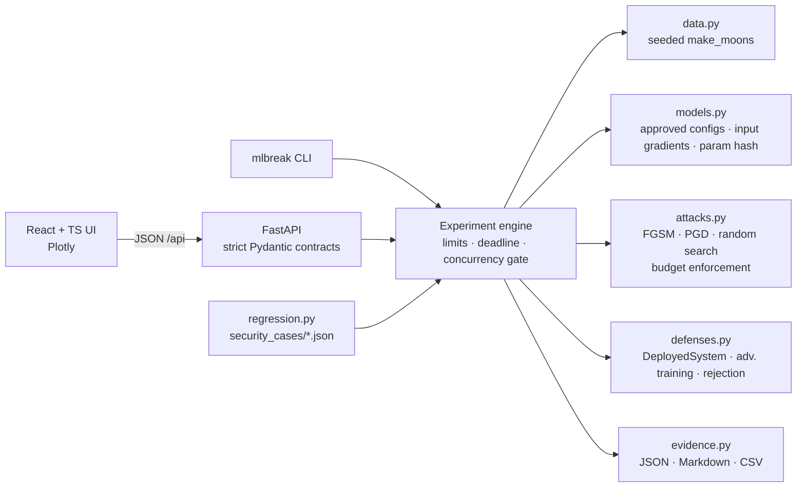

# MLBreak

**An adversarial machine learning security lab for breaking, measuring, hardening, replaying and
regression-testing traditional ML models — organised around the
[OWASP Machine Learning Security Top 10 (2023)](https://owasp.org/www-project-machine-learning-security-top-10/).**

> ⚠ **Intentionally vulnerable.** MLBreak deliberately ships an undefended model so that real
> attacks succeed against it. It is for education and defensive research. Run it locally; do not
> expose it to a network. See [docs/responsible-use.md](docs/responsible-use.md).

## Status

| OWASP category | Lab |
|---|---|
| **ML01:2023 Input Manipulation Attack** | ✅ implemented: evasion of a 2-D classifier |
| ML02–ML10:2023 | registry metadata only. **No lab, no placeholder attacks.** |

The first release is a working vertical slice, not a scaffold. Every metric in the UI, CLI and
reports comes from an experiment that actually ran.

## What the ML01 lab does

A classifier (`MLPClassifier`, tanh 16×16, or logistic regression for contrast) is trained on a
seeded `make_moons` dataset. In the lab you can:

1. **Baseline.** Evaluate the unmodified model on clean test data and inspect its decision boundary.
2. **Attack.** Pick a sample (or the whole test split) and craft an adversarial perturbation within an
   L∞/L2 budget ε:
   * **FGSM** (white-box, one step) and **PGD** (white-box, iterative). Both use exact input
     gradients, computed analytically and checked against finite differences.
   * **Random search** (black-box, decision-based). It sees only the returned label and has a
     counted query budget.
3. **Defend.** Apply a real control and evaluate it two separate ways:
   * **Replay**: the *exact* perturbations from the attack experiment are re-submitted to the
     defended system (non-adaptive attacker).
   * **Adaptive attack**: a *new* attack experiment is generated against the defended system by an
     attacker who knows the defense.
   * Controls: **adversarial training** (model-level) and **confidence rejection** (system-level
     abstention).
4. **Replay** any experiment from its recorded request and verify bit-identical results.
5. **Export evidence**: JSON (`mlbreak.experiment/v1`), a Markdown report and a per-sample CSV.
6. **Security regression**: declared invariants in `security_cases/` are re-checked by
   `mlbreak verify` and by pytest.

Reference results (seed 7, MLP, PGD L∞ ε=0.3, 150 test samples). These are produced by `mlbreak demo`:

| Evaluation | Clean accuracy | Attack success |
|---|---|---|
| Undefended | 96.7% | 39.3% (57/145) |
| Adversarial training, replay | 96.7% | 13.2% (19/144) |
| Adversarial training, **adaptive** | 96.7% | 25.5% (37/145) |
| Confidence rejection τ=0.8, replay | 86.7% (coverage 88.7%) | 0.0% (0/130) |
| Confidence rejection τ=0.8, **adaptive** | 86.7% | 15.4% (20/130) |
| Black-box random search, 500 queries/sample | 96.7% | 38.6% (56/145) |

The rejection rows are the point of the lab. Replay makes that defense look perfect; an adaptive
attacker shows it is not. Exact values can shift slightly across platforms and library versions
(see [docs/reproducibility.md](docs/reproducibility.md)).

## Architecture



| Path | Responsibility |
|---|---|
| `src/mlbreak/owasp.py` | Registry and metadata contract for ML01–ML10:2023 |
| `src/mlbreak/data.py` | Bundled, approved, generated datasets (read-only arrays, hashed) |
| `src/mlbreak/models.py` | Approved model configs, differentiable forward pass, artifact hash |
| `src/mlbreak/attacks.py` | Attacks, ε/domain projection, `enforce_constraints` |
| `src/mlbreak/defenses.py` | Deployed system (model + decision policy) and defenses |
| `src/mlbreak/experiments.py` | Baseline / attack / defend / adaptive / replay, metrics |
| `src/mlbreak/evidence.py` | Evidence store and Markdown report |
| `src/mlbreak/regression.py` | Security regression runner |
| `src/mlbreak/api.py`, `cli.py` | Web API and command line |
| `frontend/` | React + TypeScript UI |
| `security_cases/` | Declared defensive invariants |

**Vulnerable behaviour and security controls are separate.** The undefended model is the default
`DeployedSystem`. Controls are opt-in wrappers or retrained models, configured only through typed
`DefenseConfig` objects.

*Design reference:* the Normal/Attack/Secure workflow, evidence and regression-case ideas follow the
methodology of [AgentBreak](https://github.com/urcuqui/AgentBreak). That repository has no license
file, so **no code was copied**; MLBreak is an independent implementation.

## Install & run

Requirements: Python 3.11+, Node 18+ (to build the UI). Docker is optional.

```bash
make install        # .venv + pip install -e ".[dev]"
make ui             # build the React UI into frontend/dist
make run            # http://127.0.0.1:8000  (API docs at /docs)
```

Without `make`:

```bash
python3.12 -m venv .venv && .venv/bin/pip install -e ".[dev]"
(cd frontend && npm ci && npm run build)
PYTHONPATH=src .venv/bin/python -m mlbreak serve
```

Docker (UI built in the image, published on 127.0.0.1 only, read-only filesystem, all capabilities dropped):

```bash
docker compose up --build    # http://127.0.0.1:8000
```

UI development with hot reload: `make run` in one shell, `make dev` in another (http://127.0.0.1:5173).

## Test, verify, demo

```bash
make test           # pytest: unit + integration + API + regression + static security checks
make verify         # security regression gate, non-zero exit on failure
make demo           # Baseline → Attack → Defend (replay) → Adaptive → Black-box → exact replay
```

CLI reference (`PYTHONPATH=src .venv/bin/python -m mlbreak …`, or `mlbreak …` if the entry point is on PATH):

```bash
mlbreak baseline [--model logreg] [--seed 7] [--defense confidence_rejection --threshold 0.9]
mlbreak attack --attack pgd --norm linf --epsilon 0.3 --steps 40
mlbreak attack --attack random_search --queries 500
mlbreak defend <ATTACK_ID> --defense adversarial_training          # replay
mlbreak attack --defense adversarial_training --parent <ATTACK_ID>  # adaptive
mlbreak replay <ID>         # exit 0 only if results are bit-identical
mlbreak export <ID> --format md|json
mlbreak list
```

Evidence is written to `var/experiments/` (override with `MLBREAK_DATA_DIR`).

## Security properties of the platform

* Local-first: binds `127.0.0.1` by default and warns otherwise. No external credentials, no telemetry.
* Experiments never use the network. Datasets are generated, not downloaded. A static test fails if
  experiment modules import networking or deserialisation libraries.
* No arbitrary code execution. No `eval`/`exec`. Requests are strict Pydantic models with
  `extra="forbid"`, enumerated scenarios, models and attacks, and bounded numeric fields.
* No uploads and no pickle or joblib. Models are retrained from approved configurations, and
  artifacts are identified by a SHA-256 over their parameter arrays.
* Resource limits ([config.py](src/mlbreak/config.py)): ε ≤ 1, steps ≤ 200, ≤ 300 samples,
  ≤ 2000 queries/sample, 60 s wall-clock per experiment, 2 concurrent experiments (HTTP 429 beyond that).
* Experiment IDs are validated against a strict pattern before any filesystem access, which prevents
  path traversal.
* A CSP (`default-src 'self'`) and anti-framing headers are set on the UI.

## Documentation

* [Threat model](docs/threat-model.md)
* [Experimental methodology](docs/methodology.md)
* [OWASP mapping](docs/owasp-mapping.md)
* [Limitations](docs/limitations.md)
* [Reproducibility](docs/reproducibility.md)
* [Responsible use](docs/responsible-use.md)

## Troubleshooting

**`ModuleNotFoundError: No module named 'mlbreak'` on macOS.** Folders synced by iCloud/Desktop &
Documents can mark files inside `.venv` as hidden, and Python ≥ 3.12 skips hidden `.pth` files, so
the editable install disappears. The Makefile sets `PYTHONPATH=src` to avoid this. Alternatively,
keep the repository outside a synced folder, or run `chflags nohidden .venv/lib/python3.*/site-packages/*.pth`.

## License

No license has been chosen yet. Add one before publishing the repository as open source.
